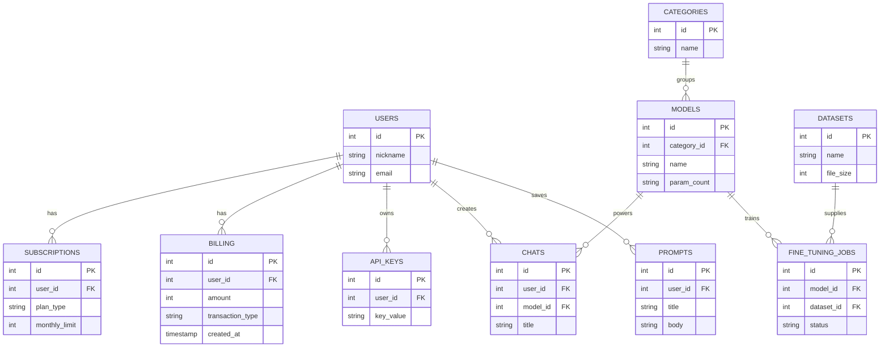
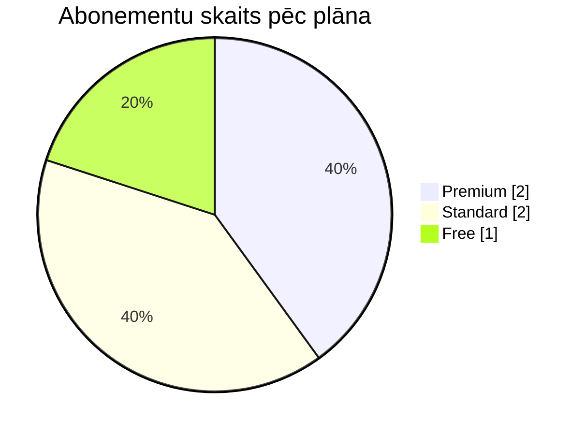
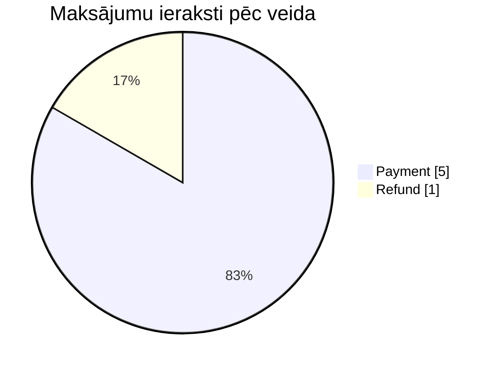
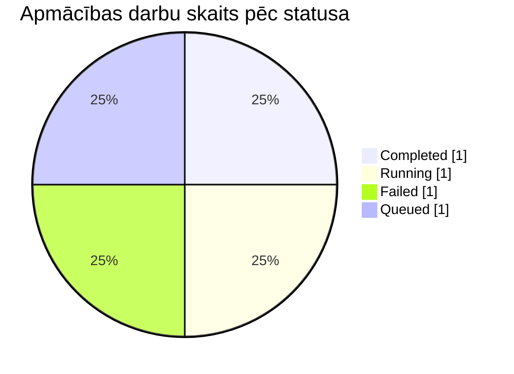

# AI Provider Platform

Vienkārša darbvirsmas lietotne AI pakalpojumu platformas datu pārvaldībai. Projekts izmanto Python, Tkinter un SQLite, un tajā ir 10 savstarpēji saistītas datubāzes tabulas.


## Iespējas

- Apskatīt platformas datus tabulās.
- Meklēt ierakstus un izvēlēties meklēšanas lauku.
- Pievienot, labot un dzēst ierakstus.
- Pārvaldīt lietotājus, abonementus, maksājumus, API atslēgas, modeļus, sarunas, uzvednes, datu kopas un apmācības darbus.
- Uzturēt datu integritāti ar SQLite ārējām atslēgām.

## Tehnoloģijas

| Tehnoloģija | Izmantojums |
| --- | --- |
| Python 3 | Lietotnes loģika |
| Tkinter | Grafiskā lietotāja saskarne |
| SQLite | Datu glabāšana un vaicājumi |

Papildu Python pakotnes nav nepieciešamas; izmantotas Python standarta bibliotēkas.

## Palaišana

Nepieciešams Python 3 ar pieejamu Tkinter moduli.

1. Atver projekta mapi terminālī.
2. Ja datubāze tiek veidota pirmo reizi, izveido tabulas un ievieto piemēra datus:

   ```powershell
   python -c "import sqlite3; db=sqlite3.connect('AI_Provider_Platform.db'); db.executescript(open('dbcreate.sql', encoding='utf-8').read()); db.close()"
   ```

3. Palaid lietotni:

   ```powershell
   python app.py
   ```

Datubāze `AI_Provider_Platform.db` tiek glabāta projekta mapē. `dbcreate.sql` izmanto `CREATE TABLE IF NOT EXISTS` un `INSERT OR IGNORE`, tāpēc inicializācijas komandu var palaist atkārtoti, nedublējot sākotnējos ierakstus.

## Datubāzes struktūra



## Piemēra datu grafiki

Grafiki attēlo ierakstus, kas tiek ievietoti no `dbcreate.sql`.

### Abonementu plāni



### Maksājumu veidi



### Apmācības darbu statusi



## Projekta faili

```text
DB_Project/
├── app.py                       # Tkinter lietotne
├── funcitons.py                 # SQLite savienojums un datu funkcijas
├── dbcreate.sql                 # Tabulu shēma un sākotnējie dati
├── AI_Provider_Platform.db      # SQLite datubāzes fails
└── README.md                    # Projekta dokumentācija
```

## Datu dzēšanas ierobežojumi

Saistītu ierakstu nevar dzēst, kamēr to izmanto cits ieraksts. Piemēram, pirms lietotāja dzēšanas ir jāizdzēš ar šo lietotāju saistītie abonementi, maksājumi, API atslēgas, sarunas un uzvednes. Tas palīdz saglabāt datu konsekvenci.